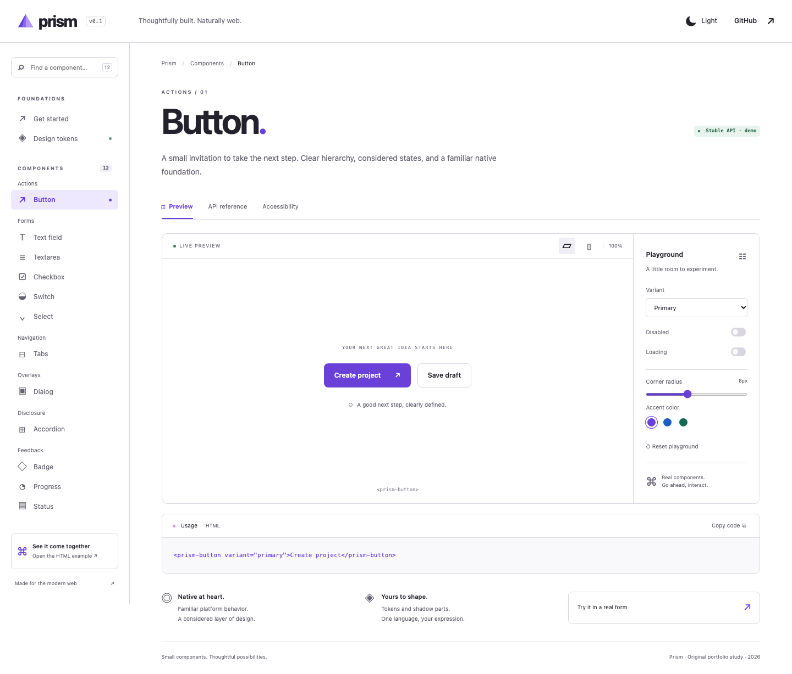

# Prism

**Small components. Thoughtful possibilities.**

An original component-library portfolio study, created November 2026. Twelve native-backed Lit elements meet a precise, interactive documentation workbench: live states, readable contracts, theme controls, a token lab, and a real HTML settings page.

[Explore the demo](https://khalilbenali1.github.io/prism-web-components/) · [Try the HTML consumer](https://khalilbenali1.github.io/prism-web-components/examples/index.html) · [Architecture and limits](docs/ARCHITECTURE.md)



## Explore

- **Actions:** button with primary, secondary, ghost, danger, disabled and loading states.
- **Forms:** text field, textarea, checkbox, switch and select. Native labels, validation, FormData, disabled fieldsets and reset through ElementInternals.
- **Structure:** automatically activated keyboard tabs, a native modal with composed-tree focus containment and restoration, and native details disclosures.
- **Feedback:** semantic badges, bounded/indeterminate progress and persistent polite status announcements.
- **Design:** scoped shadow CSS, supported custom properties/parts, two themes, three accent families and an editable radius token. No remote fonts or runtime imagery.

Each component has a working preview, typed property/attribute contract, slots, parts, events and keyboard notes. Search navigation, copyable examples, responsive previews and the token playground are functional. Hash links such as `/#dialog` are refresh-safe on the Pages subpath.

This is a fictional design system and portfolio demo, not a production client implementation or accessibility certification. No account, backend, paid service, real email or external submission is involved. Settings stay in memory and reset on reload. Nothing is published to npm.

## Run locally

Use **Node 22.23.1** and **npm 10.9.8**. Exact dependencies are in package-lock.json.

```sh
npm ci
npx playwright install chromium webkit
npm run dev
```

Open the printed URL at `http://127.0.0.1:4191/prism-web-components/`. Port 4191 is intentional: WebKit blocks reserved protocol port 4190. The HTML example consumes the built artifact; run `npm run build:package` before developing it.

```sh
npm run lint
npm run format:check
npm run typecheck
npm test                 # pure interaction rules
npm run build            # library, declarations, external consumer, docs and budgets
npm run test:e2e         # Chromium + WebKit
npm run check            # complete release checks
npm run preview          # inspect the production output
```

CI uses frozen-lockfile installation, pinned official Actions and both browser engines. Main deploys to free GitHub Pages only after its checks pass. See [verification evidence](docs/VERIFICATION.md).

## Consume the local package

`npm run build:package` creates ES modules and declarations in `package/`. A bundler can resolve the repo by its package name through a local dependency; the published HTML example does exactly this through the package's self-reference exports.

```ts
import '@khalilbenali/prism-web-components';
import '@khalilbenali/prism-web-components/tokens.css';
```

```html
<form>
  <prism-text-field label="Workspace name" name="workspace" required></prism-text-field>
  <prism-switch label="Weekly digest" name="digest" checked></prism-switch>
  <prism-button type="submit">Save changes</prism-button>
</form>
```

Listen for `prism-input` / `prism-change` / `prism-close` / `prism-toggle` / `prism-dismiss`. Events bubble and are composed; generated declarations include their details. Values are live properties; initial `value` and `checked` attributes define reset defaults. Boolean attributes use presence. Importing `tokens.css` is the explicit theme opt-in; components otherwise provide fallback tokens.

`npm run test:consumer` typechecks and bundles a temporary independent app against the package exports. The browser suite uses the separate HTML settings example, whose source imports the built package rather than src/components. The package has `private: true` to prevent accidental npm publication.

## Engineering and measured size

Lit **3.3.3**, Vite **8.3.5**, strict TypeScript **6.0.3**, Playwright **1.64.1**, axe **4.14.0**, plain CSS. TypeScript 6 is the compatible baseline for the current lint tooling, rather than unsupported TypeScript 7.

The latest measured production build (Node zlib gzip; no performance-score claims):

| Output                                           |     Raw |    Gzip |
| ------------------------------------------------ | ------: | ------: |
| Library, excluding external Lit runtime          | 23.3 kB |  5.8 kB |
| Combined documentation + HTML-example JavaScript | 95.9 kB | 27.7 kB |
| Combined CSS                                     | 26.0 kB |  6.2 kB |

Budgets fail the build above 30 kB library / 150 kB combined JS / 40 kB combined CSS. The combined figure includes both page entries; a visitor does not load both at once. There is no runtime font or image payload. Screenshots are documentation-only.

`npm audit --omit=dev` reported zero advisories on 3 November 2026. The full audit reported nine moderate development-tooling advisories inherited from minimatch's glob-parts amplification advisory ([GHSA-g3hv-75wg-m249](https://github.com/advisories/GHSA-g3hv-75wg-m249)); these tools do not ship in the static demo. No unsafe forced major-version overrides were applied.

## Boundaries

Chromium and WebKit tests cover forms, state, events, keyboard/focus behavior, live feedback, themes, long labels, reflow at 390/768/1440 and reduced motion. Axe checks support the WCAG 2.2 AA target; they do not certify accessibility. Firefox, iOS VoiceOver, localization/RTL and forced-colors OS modes need further evaluation. Modern ElementInternals and native dialog support are required. Nested shadow form ownership, nested modals, dynamic option text mutation, a notification queue and complex combobox behavior are outside this focused library. Read the component notes before adapting it to a product.

Pure progress/tab rules, documentation fixture data, specimen rendering, scoped components and page orchestration have separate responsibilities. No unnecessary store or persistence layer is introduced. See [architecture](docs/ARCHITECTURE.md), [design plan](docs/IMPLEMENTATION_PLAN.md), [visual review](docs/VISUAL_REVIEW.md) and [asset provenance](ASSETS.md).

[Mobile workbench](docs/screenshots/workbench-mobile.png) · [Dark theme](docs/screenshots/workbench-dark.png) · [Token lab](docs/screenshots/tokens-desktop.png) · [Mobile HTML settings](docs/screenshots/settings-mobile.png)

MIT for original code. Third-party packages and operating-system fonts retain their own licenses. No private client code or assets are included.
